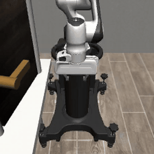
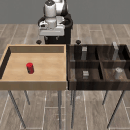
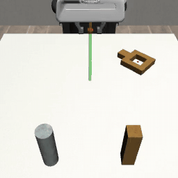

# Force2Act

**Force-Conditioned Flow Matching for Contact-Aware Robot Manipulation**

Force2Act is a robot learning policy that reads **camera images, robot state, and force/torque measurements**, then generates action trajectories with **conditional flow matching**. It is built to answer one question: *does feeding force into a generative policy help on contact-rich tasks?*

This repository contains the code for my Master's thesis: simulation data collection, training, and evaluation for force-conditioned and no-force policies.

<table>
  <tr>
    <td align="center"><a href="assets/videos/door-manipulation.mp4"></a><br><b>Door push / pull</b></td>
    <td align="center"><a href="assets/videos/object-transfer.mp4"></a><br><b>Weight sort</b></td>
    <td align="center"><a href="assets/videos/precision-insertion.mp4"></a><br><b>Nut assembly</b></td>
  </tr>
</table>

<sub>Click a GIF to open the full-quality MP4.</sub>

---

## Contents

1. [How it works](#how-it-works)
2. [Installation](#installation)
3. [Quick start](#quick-start)
4. [Step 1 – Collect simulation data](#step-1--collect-simulation-data)
5. [Step 2 – Configure an experiment](#step-2--configure-an-experiment)
6. [Step 3 – Train](#step-3--train)
7. [Step 4 – Evaluate](#step-4--evaluate)
8. [Repository layout](#repository-layout)
9. [Citation](#citation)

---

## How it works

<p align="center">
  
</p>

**Backbone (right).** Images (ResNet-18) and robot state (MLP) are encoded into context tokens. Noisy action tokens pass through *L* DiT blocks (cross-attention to the context, then self-attention, then a feed-forward network). Each block is modulated by the flow-time embedding through AdaLN, and the output is the predicted velocity.

**Flow matching.**
- **Training:** sample noise `x_0`, interpolate `x_t = (1 - t)·x_0 + t·x_1` toward the expert action chunk `x_1`, and regress the velocity `x_1 - x_0`.
- **Inference:** start from Gaussian noise and integrate the predicted velocity from `t = 0` to `t = 1` (Euler, 20 steps by default) to get a 16-step action chunk.

**Force conditioning (left).** Force is encoded with a 1D-conv encoder and injected in one of three ways. All variants share the same backbone and are selected in the config:

| `architecture` | How force is used |
| --- | --- |
| `no_force` | Baseline: the backbone only, with no force input. |
| `cross_attn` | ① Force tokens are appended to the visual and state context used by cross-attention. |
| `force_adaln` | ② The force embedding is fused with the flow-time embedding to drive AdaLN modulation. |
| `fsra` | ③ A joint cross-attention and a force-only cross-attention run in parallel. Their outputs are fused with a learnable weight. |

---

## Installation

Tested with **Python 3.10** on Linux (CUDA) and macOS (CPU / data collection).

```bash
git clone https://github.com/Yu1man/Force2Act.git
cd Force2Act

# 1. Create an environment
conda create -n force2act python=3.10 -y
conda activate force2act

# 2. (GPU only) install the PyTorch build matching your CUDA version
#    e.g. CUDA 12.1:
pip install torch torchvision --index-url https://download.pytorch.org/whl/cu121

# 3. Install everything else
pip install -r requirements.txt
```

Optional: log in to Weights & Biases (`wandb login`) to track experiments. You can always skip it with `--no-wandb`.

> All commands below are run from the repository root.

---

## Quick start

The full pipeline for the door task, end to end:

```bash
# 1. Collect 100 demonstrations
python -m sim_collect.collect door --output datasets/door_push_pull.hdf5 --episodes 100 --overwrite

# 2. Check the dataset
python -m sim_collect.validate --task door --hdf5 datasets/door_push_pull.hdf5

# 3. Train (the default config already points to this dataset)
python -m training.train --config configs/test.yaml --output-dir checkpoints/door/cross_attn_seed42

# 4. Evaluate in simulation and save a video
python -m evaluation.sim.rollout \
    --checkpoint checkpoints/door/cross_attn_seed42/final.pt \
    --episodes 5 --video checkpoints/door/cross_attn_seed42/rollout.mp4
```

---

## Step 1 – Collect simulation data

Demonstrations are collected in [robosuite](https://robosuite.ai/) with a scripted expert and saved as Robomimic-style HDF5 files with images, state, force, actions, and `train`/`valid` split masks.

```bash
python -m sim_collect.collect --list           # show all tasks
python -m sim_collect.collect door --help      # show options for one task
```

| Task | What makes it force-dependent |
| --- | --- |
| `door` | Visually identical doors must be either pushed or pulled. |
| `weight-sort` | Light and heavy cans look the same; the policy must "feel" the weight to sort them. |
| `nut-assembly` | Tight-tolerance peg insertion, replayed from Robomimic demos with live force sensing. |

**Door**

```bash
python -m sim_collect.collect door \
    --output datasets/door_push_pull.hdf5 \
    --episodes 100 \
    --overwrite
```

**Weight sort**

```bash
python -m sim_collect.collect weight-sort \
    --output datasets/weight_sort.hdf5 \
    --num-episodes 100 \
    --overwrite
```

**Nut assembly** – needs the original Robomimic `NutAssemblySquare` (`square/ph/low_dim`) dataset as a source. Download it following the [Robomimic dataset guide](https://robomimic.github.io/docs/datasets/robomimic_v0.1.html), then:

```bash
python -m sim_collect.collect nut-assembly \
    --source /path/to/robomimic/square/ph/low_dim.hdf5 \
    --output datasets/nut_assembly.hdf5 \
    --num-demos 100 \
    --overwrite
```

**Validate a dataset** (shapes, force signals, split masks):

```bash
python -m sim_collect.validate --task door --hdf5 datasets/door_push_pull.hdf5
```

Useful collection flags: `--render` (watch the expert live), `--seed`, `--val-ratio` (default `0.1`), `--image-size` (default `224`, `84` for nut assembly), and `--test-only --exclude-hdf5 <train.hdf5>` to build a held-out test set with no overlapping scenes.

---

## Step 2 – Configure an experiment

Every experiment is one YAML file. Start by copying the example:

```bash
cp configs/test.yaml configs/door_fsra.yaml
```

The settings you will change most often:

```yaml
dataset:
  hdf5_path: datasets/door_push_pull.hdf5   # which dataset to train on
  state_keys: [robot0_eef_pos, robot0_eef_quat, robot0_gripper_qpos]
  camera_keys: [agentview_image, robot0_eye_in_hand_image]
  force_keys: [robot0_eef_force]
  history: 3            # observation frames given to the policy
  action_horizon: 16    # length of each predicted action chunk
  use_force: true       # set false for the no_force baseline

model:
  architecture: fsra    # no_force | cross_attn | force_adaln | fsra
  state_dim: 9          # must match the sum of state_keys dims (see below)
  force_dim: 3
  hidden_dim: 256
  num_layers: 8

training:
  seed: 42
  output_dir: checkpoints/door/fsra_seed42
  batch_size: 64
  max_steps: 25000
  learning_rate: 0.0001

validation:
  online_rollout: true  # run the policy in simulation during training
  rollout_interval: 2000

evaluation:
  sampling_steps: 20    # flow-matching integration steps
  exec_horizon: 16      # actions executed before re-planning

wandb:
  enabled: true
  project: Force2Act
```

**Matching the config to the task**

| Task | `state_keys` | `state_dim` | `image_size` |
| --- | --- | --- | --- |
| `door` | eef_pos, eef_quat, gripper_qpos | 9 | 224 |
| `weight-sort` | eef_pos, gripper_qpos | 5 | 224 |
| `nut-assembly` | eef_pos, eef_quat, gripper_qpos | 9 | 84 (or the `--image-size` you collected with) |

**No-force baseline:** set `architecture: no_force` **and** `use_force: false`.

Optional per-modality history lengths (fall back to `history` if omitted):

```yaml
dataset:
  image_history: 3
  state_history: 3
  force_history: 5
```

---

## Step 3 – Train

```bash
python -m training.train --config configs/door_fsra.yaml
```

Checkpoints are written to `training.output_dir`:

| File | Saved when |
| --- | --- |
| `latest.pt` | every `save_interval` steps (and on Ctrl-C) |
| `best.pt` | lowest validation loss so far |
| `final.pt` | end of training |

Each checkpoint contains the model, optimizer, config, and the normalization statistics, so evaluation needs nothing else.

**Common command-line overrides** (no need to edit the YAML):

```bash
# Quick smoke test
python -m training.train --config configs/door_fsra.yaml --max-steps 20 --no-wandb

# Different dataset / seed / output folder / W&B run name
python -m training.train --config configs/door_fsra.yaml \
    --hdf5-path datasets/door_push_pull.hdf5 \
    --seed 123 \
    --output-dir checkpoints/door/fsra_seed123 \
    --wandb-name door_fsra_seed123

# Batch size, learning rate, device
python -m training.train --config configs/door_fsra.yaml --batch-size 32 --lr 1e-4 --device cuda

# Resume
python -m training.train --config configs/door_fsra.yaml --resume checkpoints/door/fsra_seed42/latest.pt
```

**Training several seeds** (as used in the thesis):

```bash
for seed in 42 123 456; do
  python -m training.train --config configs/door_fsra.yaml \
      --seed $seed \
      --output-dir checkpoints/door/fsra_seed$seed \
      --wandb-name door_fsra_seed$seed
done
```

---

## Step 4 – Evaluate

All evaluation is closed-loop in simulation, on the validation episodes of the dataset stored in the checkpoint.

**Quick rollout check**

```bash
python -m evaluation.sim.rollout \
    --checkpoint checkpoints/door/fsra_seed42/final.pt \
    --episodes 5 \
    --exec-horizon 16 \
    --sampling-steps 20 \
    --seed 104729 \
    --video checkpoints/door/fsra_seed42/rollout.mp4 \
    --output-json checkpoints/door/fsra_seed42/rollout.json
```

Add `--render` to watch live, or `--video-mode {first,all,success,failure}` to choose which episodes are recorded.

**Save a video for every validation episode**

```bash
python -m evaluation.sim.videos \
    --checkpoint checkpoints/door/fsra_seed42/final.pt \
    --output-dir videos/door/fsra_seed42
```

**Full ablation** – multiple training seeds × execution horizons × fixed evaluation seeds, with aggregated success rates:

```bash
python -m evaluation.sim.ablation \
    --checkpoints \
        checkpoints/door/fsra_seed42/final.pt \
        checkpoints/door/fsra_seed123/final.pt \
        checkpoints/door/fsra_seed456/final.pt \
    --exec-horizons 4 16 \
    --sampling-steps 20 \
    --eval-seeds 104729 130363 155921 196613 262147 \
    --output-dir results/door/fsra
```

---

## Repository layout

```text
Force2Act/
├── configs/            # experiment YAML files
├── sim_collect/        # robosuite data collection + dataset validation
│   └── sim_env/        #   door, weight_sort, nut_assembly experts
├── force2act/
│   ├── data/           # HDF5 loading, windowing, normalization, splits
│   └── models/
│       ├── components/ # encoders, embeddings, DiT blocks
│       ├── model/      # cross_attention, force_adaln, fsra
│       └── policy/     # flow-matching loss and sampler
├── training/           # training entry point and loop
├── evaluation/sim/     # rollout, video, and ablation scripts
└── assets/             # demo videos for this README
```

**Data format.** Every dataset is converted into the same episode structure, so the learning code never depends on the simulator:

```text
images   [T, N_cam, 3, H, W]   uint8
state    [T, D_state]
force    [T, D_force]          ([T, 0] for no-force)
actions  [T, 7]
```

Normalization statistics are fitted on the training split only and stored in every checkpoint.

---

## Citation

If you find this work useful, please cite:

```bibtex
@mastersthesis{force2act2026,
  title  = {Force2Act: Force-Conditioned Flow Matching for Contact-Aware Robot Manipulation},
  author = {AUTHOR NAME},
  school = {UNIVERSITY},
  year   = {2026}
}
```

## Acknowledgements

Built on [robosuite](https://github.com/ARISE-Initiative/robosuite), [Robomimic](https://github.com/ARISE-Initiative/robomimic), [MuJoCo](https://github.com/google-deepmind/mujoco), [PyTorch](https://pytorch.org/), and [timm](https://github.com/huggingface/pytorch-image-models).
